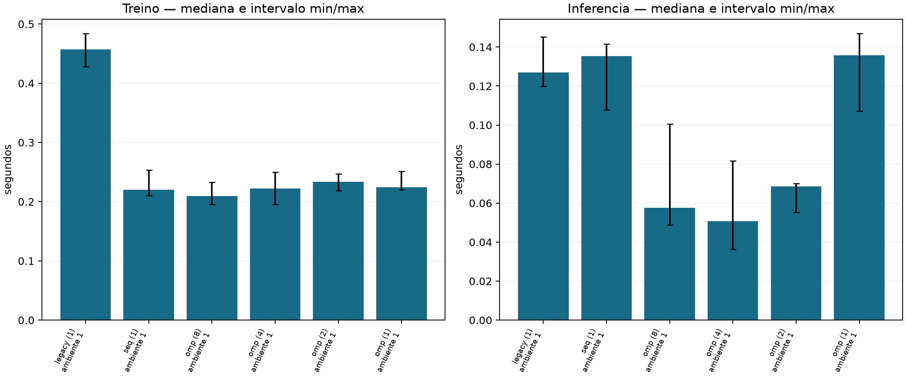

# APS 2 — Otimização CPU e migração para CUDA

O projeto mantém a rede 64 → 32 → 16 → 10, ReLU nas camadas ocultas, saída linear, SGD por amostra, taxa 0.02, 51 épocas e semente 1337 reiniciada por camada. O código original `barenn.cpp` foi preservado.

**Estado:** código, evidências, branches e três tags anotadas publicados; `main` é a branch principal. Os registros de baseline, CPU/OpenMP e CUDA funcional estão nas Issues [#1](https://github.com/gretafg/awful-barenn/issues/1), [#2](https://github.com/gretafg/awful-barenn/issues/2) e [#3](https://github.com/gretafg/awful-barenn/issues/3), fechadas e vinculadas aos respectivos marcos. São registros retrospectivos: foram publicados após a implementação, sem retroagir a cronologia. As comparações e os perfis de GPU continuam pendentes. [Histórico e limites](docs/GOVERNANCA.md).

## Resultados disponíveis

| Versão | Ambiente | Execuções | Treino em s | Inferência em s | Passagens de inferência | Validação |
| --- | --- | ---: | ---: | ---: | ---: | --- |
| Legado instrumentado | CPU local | 5 | 0.456937 | 0.126996 | 100 | 1717/1797 acertos |
| CPU sequencial otimizada | CPU local | 5 | 0.220282 | 0.135349 | 100 | Perdas e escores idênticos |
| CPU + inferência OpenMP, 4 threads | CPU local | 5 | 0.222440 | 0.050758 | 100 | Perdas e escores idênticos |
| CUDA inicial (`cuda-naive`) | GPU | Não medido | — | — | — | Compilado e lógica verificada em CPU |
| CUDA global (`cuda-global`) | GPU | Não medido | — | — | — | Compilado e lógica verificada em CPU |
| CUDA compartilhado (`cuda-shared`), bloco 128 | Franky | 1 | 0.768943 | 0.000064663 | 1 | Perdas, escores e parâmetros idênticos |

CPU local: Intel Core i5-1240P, WSL Ubuntu 22.04, GCC 11, cinco repetições em ordem embaralhada com aquecimento. A tabela informa **medianas** para CPU. Foram validadas 30 execuções: legado, sequencial e OpenMP com 1, 2, 4 e 8 threads.

O treino sequencial teve ganho de **2.07×** frente ao legado. A inferência OpenMP com quatro threads teve ganho de **2.50×** frente ao legado e **2.67×** frente ao sequencial otimizado. O treino do backend OpenMP continua sequencial: a ordem do SGD não foi alterada. A inferência sequencial otimizada não apresentou ganho nessa coleta.

GPU: execução única em 23/11/2026, com RTX A1000 observada na inspeção imediatamente anterior, nvcc 12.8.93 e driver 570.124.06. Foram 3823 amostras de treino e 1797 de teste, com 1717 acertos (95,55%). A preparação levou 1.711881 s, incluindo inicialização, alocações e H2D. O H2D de 2.432448 ms já está nessa preparação. O D2H levou 0.034912 ms.

Os tempos GPU não são medianas e não demonstram speedup frente à CPU da tabela: as máquinas e o número de passagens de inferência diferem. Também não representam o tempo total do processo, que inclui leitura e exportação. O nó exato da execução não foi gravado; a GPU foi identificada numa inspeção da mesma partição imediatamente anterior. [Saída e escopo](results/cluster/minimo/RELATO.md).



## Código e decisões

- CPU: parâmetros contíguos e espaço de trabalho fixo, evitando cópias e alocações repetidas; remoção do gradiente dos pixels que o legado calculava e descartava.
- Multicore: inferência OpenMP por imagem, pesos somente para leitura e temporários privados. O treino mantém a sequência original.
- CUDA inicial: um lançamento cooperativo por amostra; parâmetros globais e inferência com uma thread por imagem.
- CUDA global: um lançamento por época, preservando a sequência de SGD dentro do bloco.
- CUDA compartilhado: um lançamento para todo o treino, pesos compartilhados no bloco e inferência cooperativa para grupos de imagens.

O treino CUDA usa um bloco para preservar as dependências do SGD. Isso limita o aproveitamento da GPU; shared e menos lançamentos são hipóteses de melhoria, ainda sem comparação empírica dos três backends em GPU. Não foi adicionada atualização concorrente entre amostras.

## Reproduzir

Em Linux/WSL, na raiz do projeto:

```bash
make cpu test
./build/barenn_cpu --backend seq --output cpu.json
./build/barenn_cpu --backend omp --threads 4 --output omp.json
python3 scripts/compare.py cpu.json omp.json
```

No nó de acesso do Franky, para **uma execução do otimizado**:

```bash
module load cuda/12.8.1
bash scripts/run_franky_minimo.sh
```

Esse script compila no nó de acesso e executa pelo SLURM, com bloco 128, 51 épocas e uma passagem de inferência. Os nós observados não tinham todos os headers de desenvolvimento. O script grava uma pasta nova e não sobrescreve a execução já registrada.

Para compilar sem executar GPU: `make cuda`. O padrão é `sm_75` com PTX; a arquitetura pode ser indicada por `CUDA_ARCH`. A lógica dos kernels também pode ser testada em CPU com `make test-kernel-logic`, sem substituir a execução em GPU ou o Compute Sanitizer.

A bateria completa é **opcional e mais demorada**: `bash scripts/submit_franky.sh`. Ela compila no nó de acesso e submete coleta CPU e GPU com cinco repetições, verificadores e profiling. Os ajustes dos lançadores foram conferidos localmente, mas a bateria completa não foi reexecutada no cluster. [Detalhes dos comandos](COMECE_AQUI.md).

## Discussão, evidências e marcos

| Bloco | Discussão publicada | Evidência | Tag anotada |
| --- | --- | --- | --- |
| Baseline | [Issue #1](https://github.com/gretafg/awful-barenn/issues/1), [cópia](docs/issues/00-baseline.md) | [Log original](results/local/legacy-first.txt) | [v0.1-baseline](https://github.com/gretafg/awful-barenn/tree/v0.1-baseline) |
| CPU e OpenMP | [Issue #2](https://github.com/gretafg/awful-barenn/issues/2), [análise](docs/ANALISE_CPU.md) | [Manifesto](results/local/cpu-suite/manifest.json), [medições](results/local/cpu-suite/measurements.csv), [perfil](results/local/cpu-profiles/summary-legacy.txt) | [v0.2-cpu](https://github.com/gretafg/awful-barenn/tree/v0.2-cpu) |
| CUDA funcional | [Issue #3](https://github.com/gretafg/awful-barenn/issues/3), [experimento](docs/experiments/02-cuda.md) | [Saída completa](results/cluster/minimo/cuda-shared.json), [registro](results/cluster/minimo/RELATO.md) | [v0.3-cuda-funcional](https://github.com/gretafg/awful-barenn/tree/v0.3-cuda-funcional) |

As três Issues estão fechadas nos escopos documentados: referência, otimização CPU/OpenMP e migração CUDA funcional. O fechamento da terceira não afirma conclusão de profiling ou de comparações GPU ainda não realizadas. Os registros foram publicados após o trabalho; os merges locais foram preservados sem criar um histórico retroativo de Issues ou PRs. [Histórico](docs/GOVERNANCA.md), [estado da publicação](docs/PUBLICACAO.md) e [verificações](docs/VALIDACAO.md).

A validação compara as 51 perdas por época, todos os 17970 escores, previsões, matriz de confusão e parâmetros quando disponíveis. A execução CUDA preservada coincidiu exatamente com as referências locais. Ainda faltam Compute Sanitizer real, perfis Nsight e experimentos repetidos comparáveis na GPU.

Os testes de CPU, compilação CUDA, lógica dos kernels em CPU e comparação do resultado preservado foram conferidos novamente nesta cópia. [Logs e hashes da verificação local](results/local/entrega/manifest.json).

## Arquivos principais

`src/core.hpp`: CPU, dados e parâmetros. `src/main.cpp`: opções, referência e avaliação. `src/cuda_impl.cuh`: kernels e memória CUDA. `scripts/`: comparação, coleta, profiling e empacotamento. `tests/`: validações de conta, gradiente e entradas inválidas. `results/`: evidências originais, com ambiente e escopo identificados.

## Enunciado original

O texto abaixo foi mantido para consulta.

# Projeto Barenn: O Legado, a Sobrevivência e o Salto para a GPU

Era uma segunda-feira aparentemente tranquila quando a demanda chegou à sua mesa. A liderança técnica se aproximou com um sorriso contido e soltou aquela frase clássica que faz qualquer engenheiro gelar por dentro:

> "Temos um componente crítico rodando em produção há anos. O desenvolvedor original já saiu da empresa, mas agora o projeto é oficialmente seu."
    
Você procurou documentação, manuais ou notas de arquitetura e não encontrou rigorosamente nada. Restou apenas um código hermético a correr em produção.

Depois de analisar o código entendeu que é a implementação de uma Feedforward Neural Network, mas por que razão reinventar a roda? No passado, exigências estritas de conformidade e restrições de licenciamento impediram o recurso a bibliotecas de mercado. Sem alternativa, a empresa optou por criar a sua própria implementação de raiz. O resultado funcionou durante anos, mas tornou-se um labirinto técnico esquecido.

Com o aumento exponencial do volume de dados, a máquina atual começou a falhar nos prazos operacionais. Antes de qualquer migração complexa, **o seu primeiro desafio é estabilizar o código e espremer todo o desempenho possível da CPU — atacando gargalos, repensando o acesso à memória e explorando o paralelismo nativo.**

Para resolver o problema a longo prazo, a empresa adquiriu servidores blade equipados com GPUs corporativas NVIDIA. O hardware de alto desempenho já está montado no datacenter: **a sua missão final é reescrever os pontos críticos do algoritmo em CUDA e levar o processamento ao nível do paralelismo massivo.**

---

## Diretrizes de Conduta e Governança no Repositório

Neste projeto, o repositório não é apenas um local de entrega de arquivos, mas a **comprovação do seu processo investigativo de engenharia**. Espera-se uma postura estritamente empírica: nenhuma otimização deve ser feita no escuro e nenhuma melhoria de velocidade tem valor se corromper o resultado final do programa.

---

### O Princípio do Bloco Lógico de Trabalho

Você tem autonomia para decidir **o que** otimizar e **em qual ordem**, mas cada entrega deve ser estruturada como um **bloco lógico fechado**.

> **O que é um bloco lógico?**
> É uma unidade completa de intervenção técnica que engloba: **um problema identificado por profiling $\rightarrow$ uma hipótese de melhoria $\rightarrow$ a alteração no código $\rightarrow$ a validação da corretude $\rightarrow$ a medição do ganho real.**

* **Não crie tags por tempo decorrido:** Evite tags como `versao-dia-2` ou commits de "fim de expediente".
* **Não crie tags para alterações inconclusivas:** Se a alteração piorou o desempenho ou quebrou os testes, documente na Issue, reverta ou ajuste antes de formalizar o marco.
* **Toda tag deve ser reprodutível:** O professor ou qualquer colega deve conseguir executar `git checkout <tag>`, compilar o código e obter exatamente o mesmo comportamento e ordem de grandeza de desempenho documentados.

---

### O Fluxo Esperado no GitHub

Para cada intervenção técnica planejada, seu ciclo de trabalho no repositório deve seguir três pilares:

#### 1. Abertura de Issue (A Hipótese e o Ponto de Partida)

Antes de alterar uma única linha de código, abra uma Issue explicando a intenção do bloco lógico:

* **Diagnóstico:** Qual gargalo você encontrou usando ferramentas de análise (profilers)?
* **Hipótese:** Qual conceito técnico você pretende aplicar para resolver esse gargalo?
* **Métrica Base:** Qual é o tempo ou custo de processamento atual dessa rotina?

#### 2. Desenvolvimento Isolado e Commits Semânticos

* Trabalhe em uma *branch* dedicada àquela hipótese.
* Faça commits descritivos focados na causa da mudança (ex: `perf: ...`, `refactor: ...`, `fix: ...`).
* Certifique-se de que a saída do modelo/algoritmo continua correta. Código rápido que calcula resultados errados é considerado código quebrado.

#### 3. Formalização com Tag Anotada e Fechamento da Issue

Quando o bloco estiver concluído e validado, crie uma **Git Tag anotada**:

* A tag marca o estado exato da base de código naquele degrau de maturidade.
* A mensagem da tag deve resumir sucintamente o resultado alcançado.
* Feche a Issue anexando as evidências (dados de tempo, prints do profiler ou tabelas comparando o "antes e depois").

---

### Exemplo Ilustrativo de um Bloco Lógico

*(Este é apenas um exemplo de como organizar a narrativa técnica e as ferramentas; não representa um passo obrigatório ou a solução do seu problema).*

---

#### 1. Cenário: O aluno percebeu lentidão na etapa de processamento sequencial

* **Abertura da Issue #04:**
> **Título:** *Redução de tempo de computação na rotina de cálculo vetorial*
> **Contexto:** Ao inspecionar o código com o profiler, identificou-se que 65% do tempo de execução é consumido em um laço interno que realiza operações matemáticas repetitivas.
> **Métricas atuais:** Tempo total de execução: `14.2s`.
> **Hipótese:** Reestruturar a ordem dos dados para favorecer o uso de registradores e paralelizar o laço com múltiplos núcleos deve reduzir o tempo dessa rotina.


* **Implementação na branch:** `feature/otimizacao-laco-vetorial`
* Commits atômicos ajustando o laço e aplicando a estratégia escolhida.
* Verificação de que o resultado final do programa bate com o original.


* **Criação da Tag:**
```bash
git tag -a v0.3-laco-paralelo -m "Otimizacao do calculo vetorial: tempo reduzido de 14.2s para 4.8s (Speedup 2.95x). Corretude validada."
git push origin v0.3-laco-paralelo

```


* **Fechamento da Issue:**
* O aluno responde na Issue #04 anexando o comparativo de tempo (antes: `14.2s` / depois: `4.8s`), faz o merge da branch e referencia a tag criada:


> *"Otimização implementada e validada na tag `v0.3-laco-paralelo`. Issue fechada pelo PR #05."*


---

# Rubrica de Avaliação (Total: 10,0 Pontos)

<div style="background:rgba(255, 0, 0, 0.65)"> 

> ### ⚠️ CLÁUSULA ELIMINATÓRIA GERAL (CONDIÇÃO DE NOTA ZERO)
> 
> 
> A avaliação adota uma política estrita de controle de qualidade de engenharia:
> **Se em QUALQUER um dos critérios ou subcritérios de avaliação for observado o indicativo de `0,0 ponto`, a ATIVIDADE SERÁ INTEGRALMENTE ZERADA (Nota Final = 0,0).**
> Não é tolerada a ausência completa de qualquer pilar fundamental da atividade (seja por código inoperante/incorreto, falta de governança no Git ou ausência de embasamento empírico nas Issues).

* **Implementação e Desempenho Técnico:** 4,0 pontos
* **Governança, Reprodutibilidade e Tags:** 2,0 pontos
* **Relatório Técnico nas Issues (Análise e Discussão):** 4,0 pontos

</div>

---

### Critério 1: Implementação e Desempenho Técnico (4,0 pontos)

* **0,0 ponto [ZERA A ATIVIDADE]** — O código não compila, aborta durante a execução, não é funcional ou gera saídas matematicamente corrompidas.
* **+0,5 ponto** — Executou com sucesso o código legado, mediu o baseline de referência de forma reproduzível e identificou os gargalos iniciais.
* **+1,0 ponto** — Aplicou otimizações eficazes na CPU com ganhos consistentes de velocidade e paralelismo multicore preservando a integridade numérica.
* **+1,0 ponto** — **Migração Funcional para CUDA:** Porting inicial para GPU completo e correto (kernel funcional, alocação e liberação de memória no Device e transferências Host/Device íntegras).
* **+0,75 ponto** — Otimizou a execução em GPU.
* **+0,75 ponto** — Implementou técnicas avançadas em GPU, comprovando ganhos.

---

### Critério 2: Governança, Reprodutibilidade e Tags (2,0 pontos)

* **0,0 ponto [ZERA A ATIVIDADE]** — Ausência de tags, ou repositório com commit único ("tudo pronto") / commits lineares sem separação lógica, inviabilizando a reprodutibilidade dos marcos intermediários.
* **+0,5 ponto** — Utilizou tags, mas elas marcam datas/horários arbitrários em vez de blocos lógicos fechados de trabalho, ou as tags não compilam de forma independente.
* **+1,2 ponto** — Trabalho estruturado em **blocos lógicos**: cada intervenção possui uma Git Tag anotada associada a uma Issue, permitindo compilar e checar a métrica de cada versão via `git checkout <tag>`.
* **+2,0 pontos** — Reprodutibilidade e histórico impecáveis: commits atômicos com mensagens semânticas (`perf:`, `refactor:`, `test:`), branches limpas integradas via Pull Requests documentados e rastreabilidade total de cada degrau de performance.

---

### Critério 3: Relatório Técnico nas Issues (Análise e Discussão) (4,0 pontos)

#### 3.1 Profiling e Evidências Empíricas (1,5 ponto)

* **0,0 ponto [ZERA A ATIVIDADE]** — Não apresenta dados de medição nas Issues ou baseia-se unicamente em impressões subjetivas sem qualquer dado empírico.
* **+0,5 ponto** — Apresenta apenas tempos brutos de relógio (*wall-clock*) colados em texto corrido, sem dados de profilers ou repetições estatísticas.
* **+1,0 ponto** — Apresenta dados e capturas das ferramentas oficiais (**perf/callgrind** e **Nsight Systems/Compute**), mas faltam informações cruciais de ambiente (flags, parâmetros de teste ou hardware).
* **+1,5 ponto** — Issues contêm relatórios completos de profiling (CPU e GPU), métricas de hardware detalhadas (tempo de kernel vs transferência PCIe, cache misses, ocupação teórica vs real de SMs) e metodologia experimental rigorosa.

#### 3.2 Qualidade da Discussão Técnica e Argumentação de Engenharia (2,5 pontos)

* **0,0 ponto [ZERA A ATIVIDADE]** — Discussão inexistente, Issues fechadas apenas com "ok/concluído" ou explicações inconsistentes/conflitantes com os dados coletados.
* **+1,0 ponto** — Discussão puramente descritiva (lista o que foi alterado nas linhas de código, mas não analisa *por que* houve ou não ganho com base em hardware).
* **+1,8 ponto** — Discute tecnicamente a relação entre o código e o comportamento de hardware (ex: impacto do layout de memória nos caches da CPU, balanceamento de carga entre threads).
* **+2,5 pontos** — Análise técnica aprofundada: correlaciona os resultados com conceitos avançados de arquitetura (roofline model, limites da Lei de Amdahl, latência do PCIe vs throughput do kernel CUDA) e debate criticamente as decisões de engenharia tomadas.

---

## Tabela de Cenários e Balizadores

| Cenário | Situação Técnica no GitHub | Resultado / Nota |
| --- | --- | --- |
| **Desclassificado** | Tirou `0,0` em qualquer critério (ex: código não compila, sem tags, sem dados de profiling nas issues ou issues vazias). | **0,0 (Zerada)** |
| **Abaixo do Esperado** | Código compila e funciona, mas há otimizações superficiais, profiling fraco e tags incompletas. | **0,1 a 5,9** |
| **Linha de Base (Alvo: 6,0)** | CPU razoavelmente otimizada + **Migração simples para CUDA funcional** + Issues estruturadas com diagnóstico e tags atreladas. | **6,0 a 6,5** |
| **Avançado / Destaque** | CPU altamente eficiente + **CUDA com otimizações avançadas (Shared Memory/Streams)** + discussões ricas nas Issues com Nsight/Perf + governança impecável. | **8,5 a 10,0** |

---

## Formato de Entrega

A entrega consiste exclusivamente no **link do repositório no GitHub**.

1. O `README.md` principal deve atuar como o **sumário executivo do relatório**, sendo adiciocionado **NO TOPO DO README**:
* A tabela consolidada final comparando todas as versões (Baseline Legado, CPU Otimizada, CUDA Inicial, CUDA Otimizado);
* Um **índice navegável com links diretos** para cada uma das Issues/Tags que contêm a discussão detalhada;

2. Todas as branches de trabalho devem estar integradas à `main`;
3. Todas as Issues de experimentos devem estar fechadas e associadas à sua respectiva Git Tag anotada.
