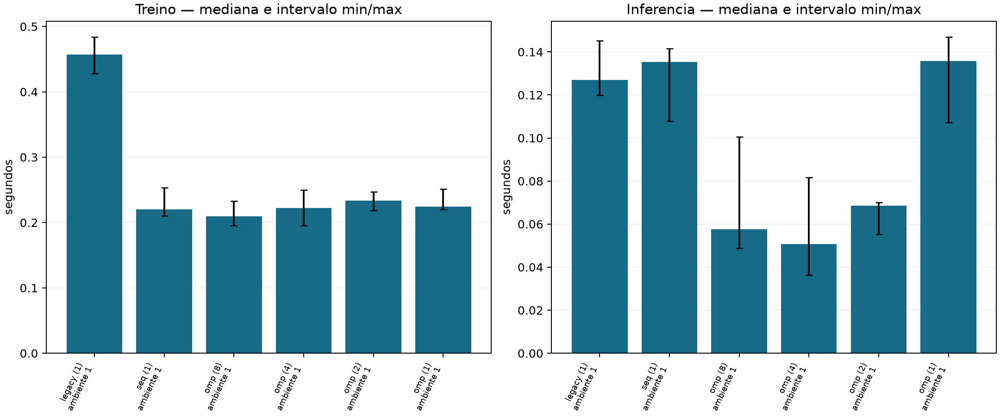

# Resultados medidos

Medianas de execucoes que passaram pela comparacao numerica. Intervalo entre colchetes: minimo e maximo.
Inferencia reporta o tempo de todas as repeticoes indicadas, sem dividir silenciosamente pelo lote.
Comparacoes entre ambientes ou nos diferentes nao isolam o efeito da implementacao.

| Ambiente | Versao | Configuracao | n | Treino em s | Inferencia em s |
| --- | --- | --- | ---: | --- | --- |
| aps2\results\local\cpu-suite | legacy | 1 | 5 | 0.456937 [0.428149, 0.484163] | 0.126996 [0.119966, 0.145151] |
| aps2\results\local\cpu-suite | seq | 1 | 5 | 0.220282 [0.210058, 0.253539] | 0.135349 [0.107777, 0.141485] |
| aps2\results\local\cpu-suite | omp | 8 | 5 | 0.209193 [0.195478, 0.232779] | 0.057579 [0.048837, 0.100652] |
| aps2\results\local\cpu-suite | omp | 4 | 5 | 0.222440 [0.195628, 0.249536] | 0.050758 [0.036397, 0.081723] |
| aps2\results\local\cpu-suite | omp | 2 | 5 | 0.233362 [0.219038, 0.246845] | 0.068462 [0.055325, 0.070041] |
| aps2\results\local\cpu-suite | omp | 1 | 5 | 0.224624 [0.220198, 0.251281] | 0.135767 [0.107312, 0.146995] |

## Escopo e interpretacao

Treino e inferencia sao intervalos separados. Na GPU, setup inclui contexto, alocacoes e envio inicial. O CSV tambem mostra tempos de device e retorno. gpu_components_s soma medianas de componentes e nao substitui uma medicao de tempo total da aplicacao.

Os perfis devem ser interpretados com os logs de hardware, comandos e flags do mesmo experimento. Nenhuma medicao em CPU local comprova ganho no Franky ou em CUDA.

